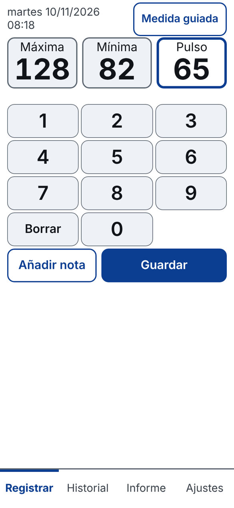
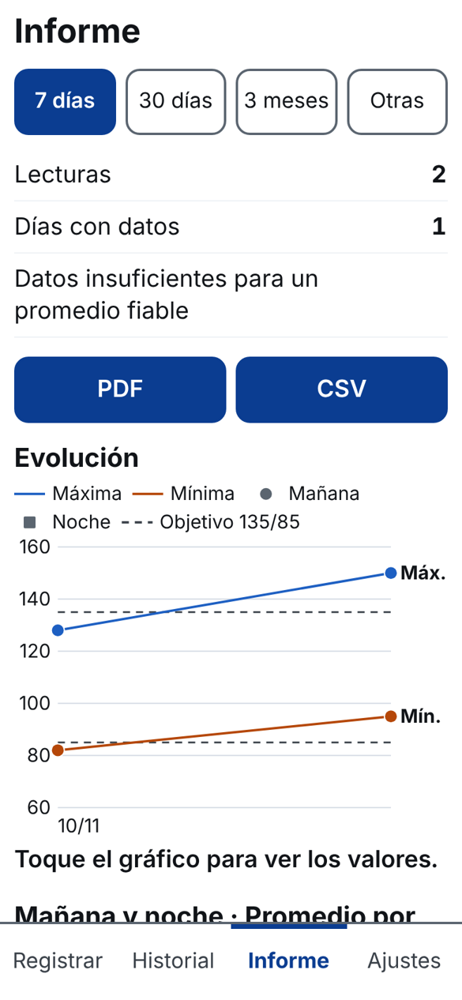
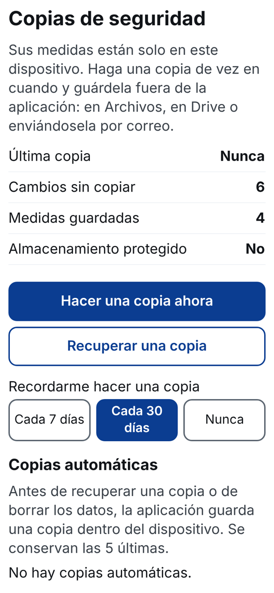

# registre-pressio

Aplicació web instal·lable (PWA) per anotar la pressió arterial al mòbil, veure'n l'evolució i generar un informe en PDF o CSV per al metge. Interfície en castellà i català.

**Les dades es desen només al dispositiu de cada persona.** No hi ha servidor, comptes ni analítica, i l'aplicació no fa cap petició fora d'aquest lloc. Aquest repositori només conté codi i documentació: no hi pugis mai còpies de seguretat (`RPS_copia_*.json`) ni exportacions.

No és un producte sanitari ni fa diagnòstics.

**Adreça de l'aplicació:** <https://xjav-dev.github.io/registre-pressio/> (quan GitHub Pages estigui activat).

| Registrar | Informe | Còpies de seguretat |
| --- | --- | --- |
|  |  |  |

Les captures són amb dades inventades.

## Què fa

- Registre de màxima, mínima i pols amb un teclat gran, i nota opcional.
- Mesura guiada opcional, amb repòs, preses i esperes configurables.
- Historial amb correcció i esborrat de mesures.
- Informe per període amb resum, gràfics, PDF i CSV.
- Còpies de seguretat en un fitxer, recuperació comprovada i recordatori.
- S'instal·la a la pantalla d'inici i funciona sense connexió.

## Publicar-la a GitHub Pages

1. El codi ja és a la branca `main`, amb `index.html` a l'arrel (i el fitxer `.nojekyll`).
2. Al repositori: **Settings › Pages › Build and deployment › Source: Deploy from a branch**, branca `main`, carpeta `/ (root)`, i **Save**.
3. Al cap d'un parell de minuts l'aplicació és a <https://xjav-dev.github.io/registre-pressio/>.

Tria bé el nom del repositori abans que ningú hi desi dades: **si canvia l'adreça, el telèfon la veu com una aplicació nova i buida**. Si mai s'ha de canviar, primer cal fer una còpia de seguretat des de l'aplicació i recuperar-la a l'adreça nova.

## Publicar una versió nova

1. Canvia `VERSIO` a `js/config.js` **i** a `sw.js` (han de coincidir; si no canvia `sw.js`, els telèfons no s'actualitzen).
2. Afegeix la versió a `CANVIS.md` i les novetats a `js/textos.js`.
3. Passa les proves i puja els canvis.

## Proves

```
node proves/executa-logica.js
node proves/executa-dades.js
node proves/executa-pwa.js
node proves/navegador.js        # opcional; necessita Playwright amb Chromium
```

Per provar-la a l'ordinador cal servir la carpeta per HTTP (per exemple `python3 -m http.server` i obrir `http://localhost:8000/`); obrint `index.html` directament no funciona el treballador de servei.

## Estructura

| Fitxer o carpeta | Contingut |
| --- | --- |
| `index.html`, `css/` | Pàgina única i estils |
| `manifest.webmanifest`, `icones/` | Instal·lació a la pantalla d'inici |
| `sw.js` | Treballador de servei: desa l'aplicació per obrir-la sense connexió |
| `js/config.js`, `js/textos.js` | Versió, límits, textos i novetats |
| `js/logica.js`, `js/grafics.js` | Validació, càlculs, CSV i gràfics |
| `js/magatzem.js`, `js/servei.js`, `js/copies.js` | Dades locals (IndexedDB), regles de negoci i còpies |
| `js/pantalles.js` | Pantalles |
| `lib/` | jsPDF 2.5.2, sense modificar |
| `proves/` | Proves automàtiques |
| `documentacio/captures/` | Captures d'aquest document |

## Documentació

- `MANUAL.md`: instal·lació al telèfon, ús i còpies de seguretat.
- `ESPECIFICACIONS.md`: abast, model de dades, regles i decisions de disseny.
- `CANVIS.md`: registre de canvis.

## Llicència

EUPL-1.2 (vegeu `LLICENCIA.txt`; el text oficial de la llicència encara s'hi ha d'incorporar). Inclou jsPDF 2.5.2, amb llicència MIT (`lib/jspdf.LICENSE.txt`).
